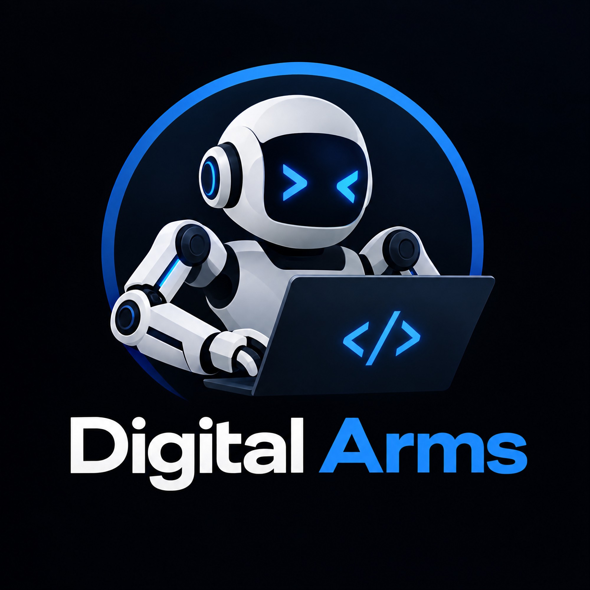
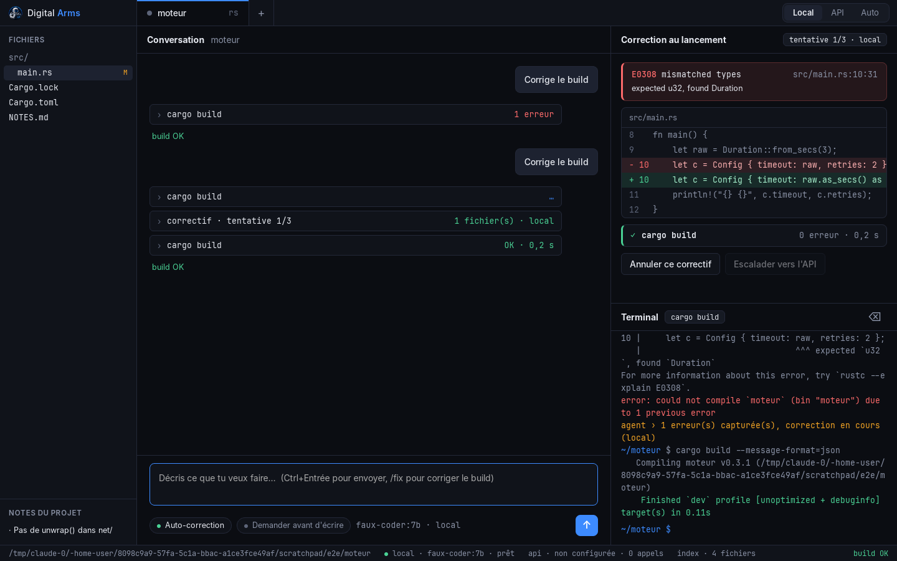

<p align="center"></p>

# Digital Arms

Agent de bureau qui **code et corrige** dans tes projets, **quel que soit le langage**.
Il tourne d'abord sur un **modèle open source local** (Ollama, LM Studio, llama.cpp…),
et peut passer à l'API Claude quand le local tourne en rond.



## Ce qu'il fait

- **Tâches libres** : « ajoute un timeout configurable au client réseau ». L'agent explore
  (symboles, recherche, lecture), édite, compile.
- **N'importe quel langage** : l'écosystème est détecté (Cargo, Go, npm/pnpm/yarn/bun, Deno,
  .NET, Maven, Gradle, sbt, Swift, Zig, Dart/Flutter, Mix, Stack/Cabal, Dune, CMake, Meson,
  Python, Ruby, PHP, Makefile…). Pour un langage inconnu, le modèle propose la commande de
  build et de test, tu valides, elle est enregistrée dans le projet.
- **Correction au lancement** : build → erreurs lues (JSON de cargo/gcc ; formats `fichier:ligne:col`,
  `fichier(ligne,col)` de tsc/MSBuild, Go ; tracebacks Python ; piles d'appels JS/Java/C#/Ruby/PHP ;
  panics Rust, pytest, go test ; à défaut, tout fichier du projet cité dans la sortie) →
  suggestions sûres du compilateur appliquées sans modèle → sinon correctif du modèle → rebuild.
  Quand le build passe, les **tests** sont lancés et leurs échecs corrigés de la même façon
  (le modèle reçoit le test et le code testé). 3 tentatives, puis escalade vers l'API en mode Auto.
- **Mémoire de conversation** : chaque échange est résumé et redonné au modèle à la demande
  suivante ; la conversation est enregistrée par projet (Nouvelle / Historique).
- **Réglages et premier lancement** : détection de la carte graphique, modèle conseillé,
  téléchargement via Ollama, clé API enregistrable.
- **Annuler ce correctif** : chaque modification est précédée d'un instantané.
- **Autorisations** : les commandes de build/lecture passent seules ; `cargo add`, `pip install`…
  demandent ton accord (avec « toujours pour ce projet ») ; `rm -rf`, `git push`, `sudo`… demandent toujours.
- **Mémoire** : `NOTES.md` (conventions lues à chaque tâche, enrichies par l'agent) et
  `.digital-arms/fixes.jsonl` (erreur → correctif qui a marché, réinjecté sur les erreurs semblables).

## Installer

Télécharge l'installateur dans l'onglet **Releases** du dépôt (Windows `.exe`/`.msi`,
Linux `.deb`/`.AppImage`, macOS `.dmg`), puis installe un modèle local :

```bash
ollama pull qwen2.5-coder:14b
```

Publier une nouvelle version : changer `"version"` dans `src-tauri/tauri.conf.json` (et dans
`Cargo.toml`), pousser sur `digital-arms` — GitHub Actions construit les installateurs et crée
la Release `vX.Y.Z`.

## Compiler depuis les sources

Prérequis : Rust stable, Node 20+, et pour l'app de bureau les dépendances système de
[Tauri 2](https://v2.tauri.app/start/prerequisites/) (WebView2 sous Windows, rien sous macOS,
`libwebkit2gtk-4.1-dev` sous Linux).

```bash
# 1. un modèle local (exemple avec Ollama ; RTX 3080 10 Go → 7B à 14B en Q4/Q5)
ollama pull qwen2.5-coder:14b

# 2. l'application
cd ui && npm install && cd ..
cargo install tauri-cli --version "^2"
cargo tauri dev                          # ou : cargo tauri build
# ouvrir un projet directement : target/debug/digital-arms ~/projets/moteur-rust
```

Sans Tauri, le moteur s'utilise en ligne de commande :

```bash
cargo run -p da-cli -- -C ~/projets/moteur-rust doctor     # vérifie le modèle local et l'API
cargo run -p da-cli -- -C ~/projets/moteur-rust fix        # compile et corrige
cargo run -p da-cli -- -C ~/projets/moteur-rust run "ajoute un timeout configurable"
cargo run -p da-cli -- new go mon-api                      # n'importe quel langage
cargo run -p da-cli -- new "Zig" mon-jeu                   # hors squelettes intégrés : l'agent l'écrit
cargo run -p da-cli -- -C . index --find parse_config      # index structurel
```

L'interface seule (navigateur, backend factice qui rejoue un scénario) : `cd ui && npm run dev`.

## Configuration

`~/.config/digital-arms/config.toml` (global) puis `<projet>/.digital-arms/config.toml` :

```toml
mode = "auto"            # local | api | auto
max_attempts = 3         # tentatives de correction avant abandon / escalade
auto_fix = true          # build + correction après chaque tâche
confirm_writes = false   # demander avant chaque écriture
# build_cmd = "cmake --build build"   # sinon détecté automatiquement

[local]
base_url = "http://localhost:11434/v1"   # LM Studio : http://localhost:1234/v1
model = "qwen2.5-coder:14b"
text_tools = false       # true si ton modèle gère mal le tool calling natif

[api]
model = "claude-opus-5-5"
effort = "high"
```

La clé API se donne par variable d'environnement : `ANTHROPIC_API_KEY`. Sans clé, le mode
Auto reste 100 % local.

## Organisation

| Dossier | Rôle |
|---|---|
| `crates/da-core` | Le moteur : LLM, diagnostics, outils, index, mémoire, boucle d'agent |
| `crates/da-cli` | Binaire `da` |
| `src-tauri` | Shell de bureau (Tauri 2) |
| `ui` | Interface (TypeScript + Vite, sans framework) |
| `docs/ARCHITECTURE.md` | Choix techniques et feuille de route |

Tests : `cargo test` (dont des tests de bout en bout avec un faux serveur de modèle et de vrais builds cargo).
