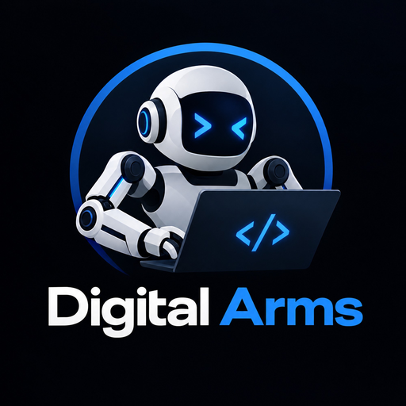
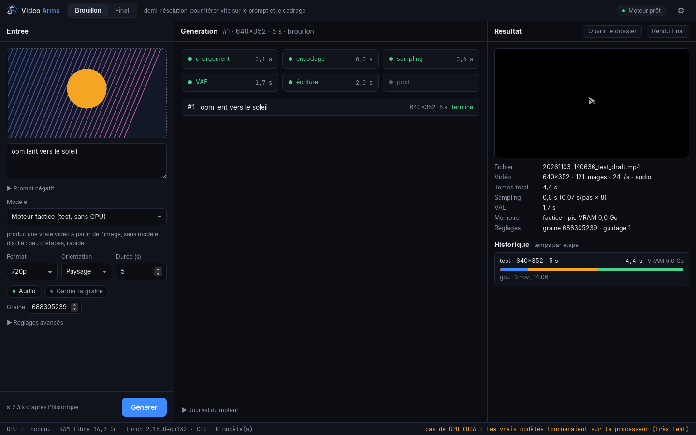
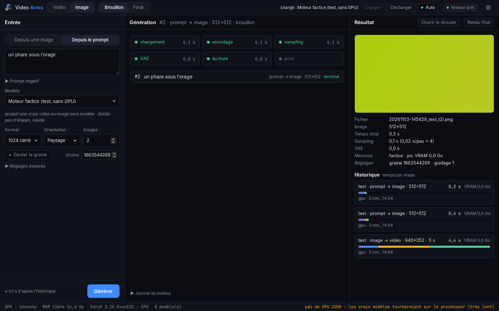

<p align="center"></p>

# Video Arms

Application de bureau **image → vidéo**, **prompt → vidéo**, **prompt → image** et **image → image**
avec les modèles open source installés sur ta machine (LTX-2 / 2.3, Wan 2.2, SDXL, SD 1.5…), pensée
pour un GPU grand public : 10 Go de VRAM et beaucoup de RAM.

Ce qu'elle apporte par rapport à lancer un modèle « à la main » :

- **Brouillon → Final.** Le brouillon tourne en demi-résolution pour itérer vite sur le prompt et
  le cadrage ; le rendu final reprend la même graine à la résolution demandée. On ne jette plus de
  rendus longs.
- **Mémoire gérée comme une stratégie.** Le modèle tient-il dans la VRAM ? Sinon, ses blocs sont
  streamés depuis la RAM pendant le calcul (même idée que les moteurs « experts streamés » pour
  LLM), ou chargés composant par composant selon le nombre d'étapes. Le VAE est tuilé dès 720p.
  Tout est mesuré et affiché.
- **Profil de chaque génération.** Temps par étape (chargement, encodage, sampling, VAE, écriture,
  post-traitement), secondes par pas, pic de VRAM et de RAM, stratégie utilisée. L'historique sert
  à estimer la durée des prochaines générations.
- **Audio** avec les modèles qui en produisent (LTX-2), interpolation et upscale ffmpeg sans modèle.
- **Modèles chargés sous contrôle.** En mode Auto, l'app charge et remplace les modèles selon la
  tâche ; sinon tu charges et décharges toi-même (la VRAM est à toi). Le modèle chargé est affiché.
- **Onglet Image** : SDXL et SD 1.5 en dossiers diffusers ou en fichiers `.safetensors` uniques
  (famille lue dans l'en-tête), modèles distillés (Turbo, Lightning) en 4 étapes, plusieurs images
  d'un coup avec graines consécutives.
- **Rien n'est téléchargé** : l'app repère les modèles déjà présents (caches Hugging Face,
  dossiers diffusers). Les formats GGUF/ComfyUI sont détectés mais pas encore utilisables.




## Installer

1. Télécharge l'installateur dans **Releases** (Windows `.exe`, Linux `.deb`/`.AppImage`, macOS `.dmg`).
2. Il faut **Python 3.10 à 3.13** sur la machine (python.org, coche « Add to PATH »). Pas besoin
   d'installer torch ou diffusers toi-même : l'app crée son propre environnement.
3. Au premier lancement, ouvre les réglages (⚙) : choisis Python, clique **Installer le moteur**
   (plusieurs minutes, torch CUDA est gros), ajoute le dossier de tes modèles, enregistre.

Un modèle local prêt à l'emploi sur 10 Go : **LTX-2.3 distillé** (format diffusers). Wan 2.2 5B
marche aussi, plus lentement (50 étapes).

## Utiliser sans l'interface

```bash
cd engine
python -m venv .venv && .venv/bin/pip install -e ".[models]" -r requirements-cuda.txt
.venv/bin/python -m videoarms.cli probe  ~/modeles
.venv/bin/python -m videoarms.cli gen --paths ~/modeles --model "ltx2:/chemin/vers/LTX-2.3-Distilled" \
    --image photo.jpg --prompt "la caméra avance lentement" --seconds 5 --width 1280 --height 720
.venv/bin/python -m videoarms.cli gen --model mock --image photo.jpg --prompt test   # sans GPU
```

## Organisation

| Dossier | Rôle |
|---|---|
| `engine/` | Moteur Python : backends (LTX-2, Wan, factice), stratégie mémoire, écriture vidéo, protocole JSON |
| `src-tauri/` | Coque de bureau (Tauri 2) : installation du moteur, processus, dialogues |
| `ui/` | Interface (TypeScript + Vite) |
| `docs/ARCHITECTURE.md` | Choix techniques, ce qui est mesuré, feuille de route |

Tests : `cd engine && python -m pytest` (vraies vidéos produites avec le moteur factice, protocole
testé à travers un vrai sous-processus, annulation comprise). Les backends LTX-2 et Wan ne peuvent
être vérifiés que sur une machine avec GPU.

## Publier une version

Changer `"version"` dans `src-tauri/tauri.conf.json` (et `Cargo.toml`, `ui/package.json`) et
pousser sur la branche `video-arms` : GitHub Actions construit les installateurs et crée la Release `video-arms-vX.Y.Z`.
